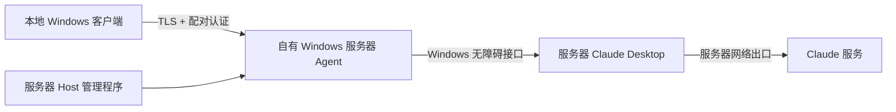

# ServerLink

**在本地 Windows 窗口，操作自有 Windows 服务器上的 Claude Desktop。**

Windows x64 · .NET Framework 4.8 · 当前版本 0.2.9 · MIT

作者QQ：**230154231**

## 为什么做这个项目：IP 与运行环境稳定性

如果你担心特定本地出口 IP 带来的使用问题，或经常切换电脑、网络，希望 Claude 始终留在自己的服务器环境中运行，ServerLink 提供一个独立的本地操作窗口。

Claude 进程、账号登录和任务执行留在服务器。本地客户端连接自己的服务器桥接程序，Claude 的实际网络出口取决于服务器网络配置。这样可以减少更换本地设备或本地网络时对执行环境的影响。

**固定运行环境不等于保证防封号。** 本工具不能验证某次封号是否由 IP 导致，也不判断某个 IP 是否被服务商标记；不提供账号解封、风控检测规避或地区身份伪装的能力。请在服务商允许的使用范围内使用自己的账号与服务器。更多说明见 [IP 与账号稳定性](docs/ip-and-account-stability.md)。

## 当前能做什么

- 本地独立 Windows 窗口，读取服务器当前会话及界面中可见的最近会话。
- 向原会话发送文字，显示真实回复；正常配置后，日常无需打开远程桌面。
- 点击“＋ 新增会话”，打开服务器普通新聊天，确认首条消息建立的正式会话，支持新旧会话往返与草稿恢复。
- 新建和写操作保留请求编号及执行记录；未领取的过期任务不执行，未知结果不会自动重试。
- TLS 连接、服务器证书指纹校验及配对密钥认证。
- 本地草稿和待核对消息加密保存；断线后核对，不自动重发。
- 处理单行末尾空白行、普通段落空行及部分代码块显示差异。
- 本地客户端、服务器管理和桥接程序每次启动显示作者信息。弹窗不阻塞后台运行。

**这是聊天试用版，尚不是 Claude 全功能客户端。** 项目、Code 任务接管、附件、语音、全部历史及完整 Markdown 尚未完整交付。服务器重启无人登录、独立锁屏及停止回复的完整场景也没有全部验收。见 [路线图](docs/roadmap.md)。

## 下载与使用

从 [Releases](https://github.com/TTTAAXXTTT/ServerLink/releases) 下载完整包，或分别下载本地端和服务端。发布包不附带 Claude 程序、账号、服务器或访问密钥。

1. 在自己的 Windows 服务器上安装并正常登录 Claude Desktop。
2. 将服务器 Host、Agent 放在同一个固定文件夹，打开 Host 配置后台运行并启动桥接。
3. 允许本地电脑访问服务器桥接 TCP 39443 端口。
4. 在本地打开 Client，粘贴服务器生成的配对信息并连接。
5. 测试收发，断开维护远程桌面后再测试一次。保持服务器 Claude、桥接和已登录的 Windows 用户会话运行。

详细步骤：[部署与升级](docs/setup.md) · [常见问题](docs/troubleshooting.md)。本地不安装 Claude，也不显示服务器整个桌面。

## 工作方式



桥接通过原应用的 Windows 无障碍接口读取和操作现有界面，因此兼容性会受 Claude 版本、语言、界面结构和服务器用户会话状态影响。它不是 Anthropic 官方客户端，也不是官方会话 API。架构与数据边界见 [架构说明](docs/architecture.md)。

## 从源码构建

需要 Windows x64 和 .NET Framework 4.8。无需额外 NuGet 包。

在允许运行本地脚本的 PowerShell 环境中：

```powershell
.\build.ps1 -OutputDirectory .\dist
.\test.ps1
```

构建产生 `ServerLink.Client.exe`、`ServerLink.Host.exe`、`ServerLink.Agent.exe`。构建脚本调用 Windows 自带的 .NET Framework C# 编译器。若设备策略不允许运行脚本，请使用策略允许的构建环境或按脚本中列出的参数直接调用编译器，不需要修改系统防护。

`test.ps1` 只编译并运行独立客户端、解析和操作记录检查，不连接真实服务器。源码中的 `Live*` 诊断工具可能访问服务器或发送真实消息，不包含在默认检查中。详见 [测试说明](docs/testing.md)。

## 项目目录

```text
src/          客户端、Host、Agent、传输与界面适配源码
tests/        回归与诊断源码
preview/      独立作者弹窗预览源码
docs/         部署、架构、排障、测试、使用场景与路线图
reports/      0.2.8 / 0.2.9 的公开脱敏检查结果
.github/      自动构建、问题模板与变更模板
build.ps1     构建本地端和服务端
test.ps1      默认独立回归检查
```

## 检查状态

0.2.9：36 项客户端、9 项解析/传输、8 项操作记录检查通过。已在 Windows 服务器 / Claude Desktop 4.29.0 上验证普通新建、首条发送、真实回复、旧草稿恢复；无活动 RDP 的检查及回执丢失恢复记录见 [0.2.9 验证范围](docs/validation-0.2.9.md) 和 [reports](reports)。运行 Agent 的哈希与交付包一致。其他机器、Claude 版本及并发人工操作边界需要分别验证。

## 贡献与许可

欢迎提交问题和改进：[贡献指南](CONTRIBUTING.md) · [安全说明](SECURITY.md) · [更新记录](CHANGELOG.md)。

采用 [MIT License](LICENSE)。Claude 及相关商标归相应权利人所有，本项目与 Anthropic 无隶属关系。
